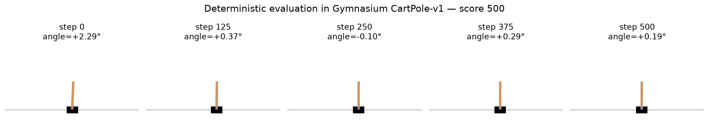
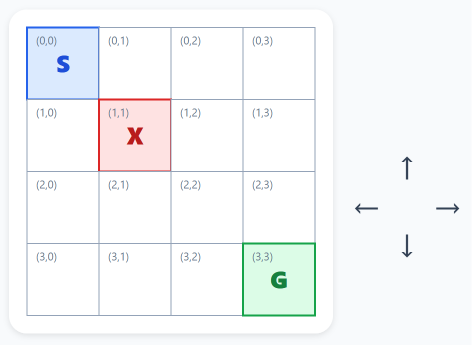
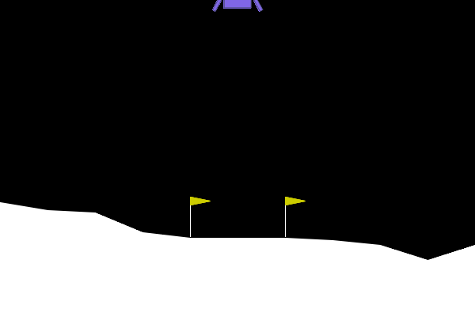

import { Aside } from '@/components/user'
/* - note - 蓝色信息提示
   - tip - 紫色技巧提示
   - caution - 黄色警告提示
   - danger - 红色危险提示 */

## 关于本篇

写者的上一篇 RL Note 还是在上半年 5 月份，这期间写者对 RL 有了许多的理论性探索：无论从 Agent 还是 Embodied AI 的角度，我发现纯粹的 RL 理论十分吃数学功底，对新手不太友好，没有脚踏实地的感觉。

所以，特此暂停之前的理论学习，转而来完善实操部分的代码书写和训练调优。真正的从 real experiment 出发，去理解 RL 的本质。

> 注：本篇的实操内容皆参考 [Hands-On Modern RL](https://walkinglabs.github.io/hands-on-modern-rl/preface/introduction) 教程，特此感谢 🙇‍

## CartPole（倒立摆）

**最简单的强化学习训练。RL 界的 "Hello World"**

> 训练流程：on-policy 采集 → GAE 算优势 → PPO 裁剪更新 → KL/clip 监控

> 关键词：MDP、Actor-Critic、on-policy、GAE、PPO Clipped、KL Divergence

- 状态: $s_t=[x_t, \dot{x}_t, \theta_t, \dot{\theta}_t]$
- 动作: $\mathcal{A} = \{0, 1\}$，表示向左/右推小车
- 奖励: $r_t=1$，每步奖励 1，直到小车倒下

其他细节可查看 [Details_for_CartPole](https://github.com/Lou-uo/Reinforcement-Learning/blob/main/chapter01_cartpole/core_code.ipynb)。

## GridWorld（网格世界）

**短小且完整的价值学习算法。RL 界的 “果蝇”**

> 训练流程：初始化 Q 表 → 不同算法(Q-Learning…) 选动作 → TD 更新

> 关键词：Bellman、ε-greedy、UCB、TD、Q-learning、off-policy……

- 状态: 4 $\times$ 4 网格 `(row, col)`
- 动作: 4 个离散方向
- 奖励: 普通步 -0.01 ; 进入目标 +1.0 ; 进入陷阱 -1.0

其他细节可查看 [Details_for_GridWorld](https://github.com/Lou-uo/Reinforcement-Learning/blob/main/chapter03_mdp/core_code.ipynb)

## LunarLander（登月着陆器）

> 训练流程(DQN)：ε-greedy 交互采样 → 存入经验回放池 → 随机小批量采样 → TD 目标 r + γ·max Q_target(s') → MSE 梯度更新 Q 网络 → 定期同步目标网络

> 关键词：DQN、经验回放、 ε-greedy、TD 自举、off-policy、target network、MSE loss、Bellman equation、Double DQN……

- 状态: 8 维 - `[x, y, x速度, y速度, 杆角度, 角速度, 左着陆腿接触, 右着陆腿接触]`
- 动作: 4 个离散 - 0 不动, 1 左引擎, 2 主引擎, 3 右引擎
- 奖励（塑性设计）:
    - 每步 −0.03 燃料/时间惩罚，鼓励快着陆
    - 从 100 分起步，按距离着陆点衰减
    - 与地面/障碍物接触 ±100；坠毁重罚
    - 两腿同时接地 +100（成功着陆）

其他细节可查看 [Details_for_LunarLander](https://github.com/Lou-uo/Reinforcement-Learning/blob/main/chapter04_dqn/core_code.ipynb)

## Pong（Atari 游戏）

